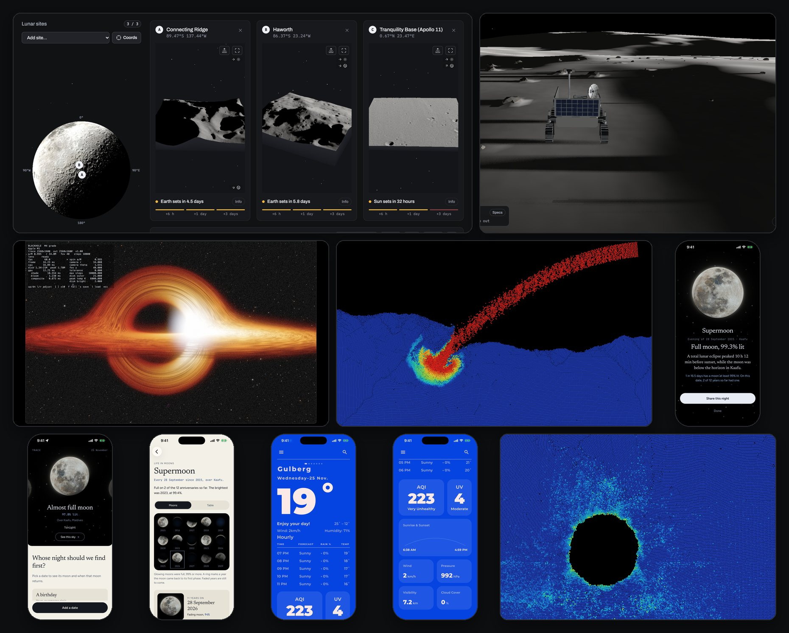

Software engineer from Lahore, Pakistan. Our team won the local event of NASA Space Apps 2026. 
I build mobile apps and graphics code, and I measure frame times and bytes before I change anything.

[ukasha167.is-a.dev](https://ukasha167.is-a.dev/) &nbsp;·&nbsp;
[linkedin](https://www.linkedin.com/in/ukasha167/) &nbsp;·&nbsp;
[email](mailto:ukashaanwar167@gmail.com)

 

 

<samp>apps&nbsp;&nbsp;&nbsp;&nbsp;&nbsp;typescript · react native · expo · skia · dart · flutter</samp> 
<samp>web&nbsp;&nbsp;&nbsp;&nbsp;&nbsp;&nbsp;three.js · webgl · react · node · postgres</samp> 
<samp>systems&nbsp;&nbsp;c · c++23 · metal · rust · swift · raylib · cmake</samp> 
<samp>ml&nbsp;&nbsp;&nbsp;&nbsp;&nbsp;&nbsp;&nbsp;python · insightface · onnx runtime</samp>

**[Lunar Landing Site Navigator](https://github.com/ukasha167/lunar-landing-site-navigator)** &nbsp;·&nbsp; <samp>three.js, webgl</samp> &nbsp;·&nbsp; [live](https://lunar-landing-site-navigator.pages.dev/) 
Won our local NASA Space Apps 2026 event; built in the two days of the hackathon. 
Compares Moon landing sites against their real skyline from NASA maps. 
802 of 802 Sun and Earth positions match JPL Horizons. Terrain builds went 
from 198 ms to 7.7 ms, and the page needs 6.2 MB before its first frame.

**[TRACE](https://github.com/ukasha167/TRACE)** &nbsp;·&nbsp; <samp>react native, skia</samp> 
Offline astronomy app. Give it a date and a place and it shows that night's 
moon at its real phase and tilt, how rare it was, and the years it comes back. 
The moon is lit per pixel in a shader, and the sky view draws 6,331 stars and 
25 constellations. 253 unit tests, 189 of them on the astronomy. APK on GitHub.

**[blackhole-sim](https://github.com/ukasha167/blackhole-sim)** &nbsp;·&nbsp; <samp>c++23, metal</samp> 
Real-time Kerr black hole ray tracer, 55 fps at 2560 x 1600 on an M1 Air. 
It traces light once into a cached lens map, then shades each frame from it. 
55 built-in tests check the physics against exact formulas.

**[Particle-Simulation](https://github.com/ukasha167/Particle-Simulation)** &nbsp;·&nbsp; <samp>c++23, raylib</samp> 
100,000 particles on 4 CPU threads of an M1 Air, no GPU compute: 14 ms a step. 
Data sits in flat arrays. A uniform grid and a counting sort find neighbours 
every frame, so each particle only checks the particles next to it.

**[MomentLens](https://github.com/MomentLens/app)** &nbsp;·&nbsp; <samp>python, onnx, react native</samp> 
Final-year project with two classmates: a shared wedding album where a guest 
can have their face blurred in every photo. I own the face worker: InsightFace 
on ONNX Runtime, 12 ms face detection on an M1 with Core ML, close to 200 tests.

**[quotatop](https://github.com/ukasha167/quotatop)** &nbsp;·&nbsp; <samp>rust</samp> 
A terminal dashboard for Claude Code and Codex usage limits. 1.1 MB binary, 
8 MB of memory, 0.1 to 0.25% of one core. Reads no credentials.

**[MIRROR](https://github.com/ukasha167/MIRROR)** &nbsp;·&nbsp; <samp>swift, kotlin</samp> 
Android phone apps in their own Mac windows, over adb, with a patched 
scrcpy-server. File pushes resume across USB and Wi-Fi at 25 MB/s. 89 tests.

**[CAST](https://github.com/ukasha167/CAST)** and **[DRAFT](https://github.com/ukasha167/DRAFT)** &nbsp;·&nbsp; <samp>flutter</samp> 
CAST is a weather app where the temperature fills the screen. DRAFT is an offline 
book catalog for a bookstore with no signal: SQLite FTS5 search on the phone.

**[CRAVE.](https://github.com/ukasha167/CRAVE.)** &nbsp;·&nbsp; <samp>react native, postgres</samp> 
Food ordering app built with a friend, who wrote the backend. I made the app. 
Checkout runs in one Postgres transaction, so a failed order can't charge 
twice. Delivery tracking is a 3D map in Three.js with Dijkstra routing.

**[space-shooters](https://github.com/ukasha167/space-shooters)** &nbsp;·&nbsp; <samp>c, raylib</samp> 
Synthwave 3D shooter in C, about 300 FPS uncapped. The glow is additive blending, 
with no bloom pass.

 

The stats are drawn from the GitHub API and refreshed daily. The screens are from the projects themselves. The "1.67" is set in Cochin.
